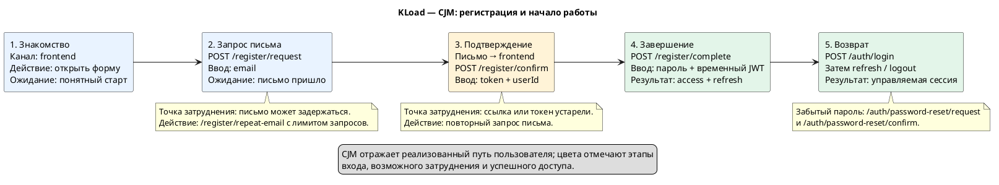
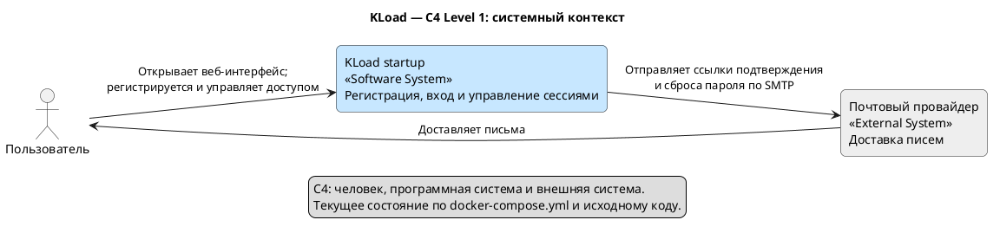
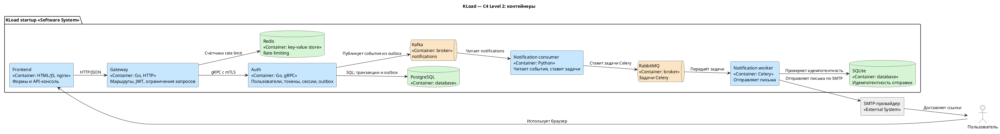
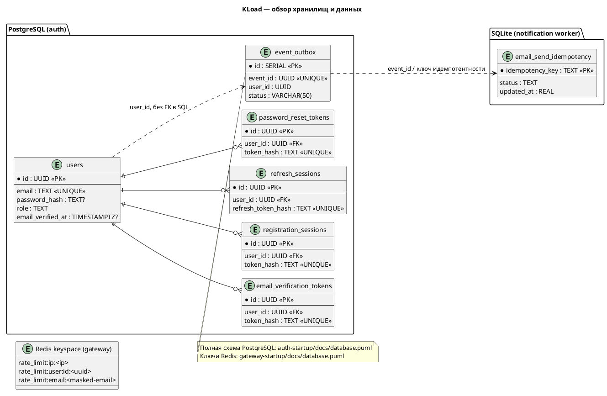

# Диаграммы KLoad

Исходники PlantUML (`.puml`), изображения PNG для просмотра в Markdown и SVG
для масштабирования лежат в каталоге `diagrams/`.

## Путь пользователя (CJM)

## C4: системный контекст

## C4: контейнеры

## Хранилища и данные

Подробности: [Auth](https://github.com/Weit145/auth-startup/blob/confirm-email/docs/README.md) и
[Gateway](https://github.com/Weit145/gateway-project-service/blob/main/docs/README.md).
