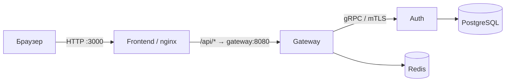
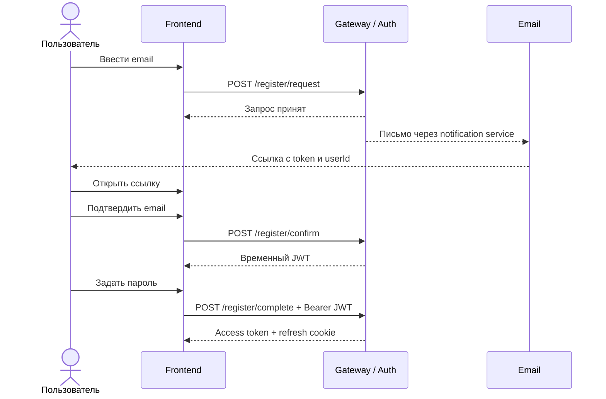

# KLoad API Testing Console

Статический frontend для ручной проверки gateway/auth flow в
[Auth project (KLoad)](https://github.com/Weit145/auth-project).
Публичный API предоставляет [gateway-project-service](https://github.com/Weit145/gateway-project-service),
операции с аккаунтами выполняет [auth-startup](https://github.com/Weit145/auth-startup/tree/confirm-email).

## Взаимодействие сервисов

Frontend обслуживает статические файлы и проксирует API-запросы. Gateway проверяет
запросы и токены, Auth выполняет операции с учётными записями, PostgreSQL хранит
пользователей и сессии, а Redis используется для ограничения частоты запросов.

## Запуск

После запуска корневого Docker Compose откройте:

- UI: http://localhost:3000
- Swagger через frontend proxy: http://localhost:3000/swagger/index.html

Frontend отправляет запросы на `/api/*`; Nginx проксирует их в `gateway:8080`.
Благодаря одному origin браузер может использовать HttpOnly refresh cookie без CORS-настроек.

## Регистрация

Регистрация состоит из трёх шагов:

1. `POST /register/request` — только `email`; повторное письмо через `/register/repeat-email`.
2. `POST /register/confirm` — `token` и `userId` из письма; ответ содержит временный JWT.
3. `POST /register/complete` — `password` в JSON и временный JWT в `Authorization: Bearer …`.

Временный JWT хранится отдельно в `sessionStorage` текущей вкладки и переживает перезагрузку.
После завершения регистрации он удаляется, а access token и пользователь сохраняются как сессия входа.
При истечении временного JWT нужно повторно запросить письмо и подтвердить адрес.
API-консоль поддерживает тот же поток и автоматически использует временный JWT для `/register/complete`.

Имя при регистрации больше не используется. Login, refresh, logout и восстановление пароля остаются на `/auth/*`.
